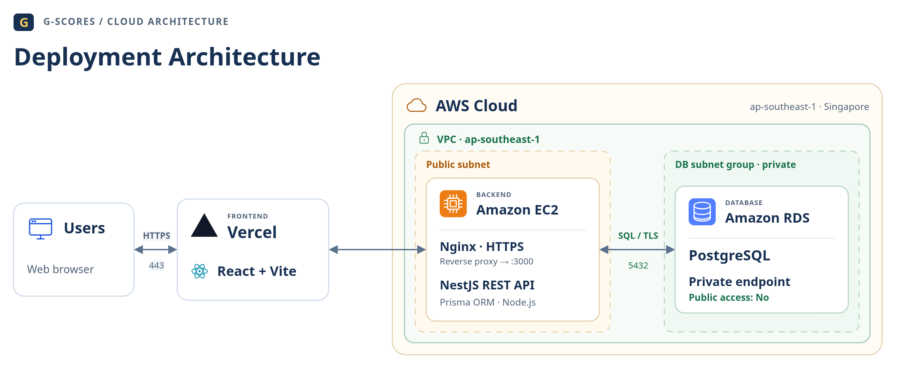

# G-Scores

A React frontend and NestJS backend for looking up and analyzing 2024 Vietnamese national high school exam scores.

## Demo and deployment

**Live demo:** [**https://g-scores-eight.vercel.app/**](https://g-scores-eight.vercel.app/)



## Run locally

Run commands from the project root. Use either npm or Docker.

Install Docker with Compose and start Docker. For npm, also install Node.js 24 and npm.

Place the dataset at `data/diem_thi_thpt_2024.csv`.

### 1. Configure environment files

Create missing environment files:

```sh
test -f apps/api/.env || cp apps/api/.env.example apps/api/.env
test -f apps/web/.env || cp apps/web/.env.example apps/web/.env
```

Set `POSTGRES_PASSWORD` in `apps/api/.env`. For an existing database, keep its current credentials.

Remove any stale `DATABASE_URL` when using the local database.

### 2A. Run with npm

Stop Docker application services and start PostgreSQL:

```sh
docker compose --env-file apps/api/.env --env-file apps/web/.env \
  stop api web
docker compose --env-file apps/api/.env --env-file apps/web/.env \
  up -d --wait db
```

Install dependencies on the first run or after lockfile changes:

```sh
npm run setup
```

Start the application:

```sh
npm run dev
```

Wait for the `API:` log message. The first CSV import may take a few minutes.

Open [http://localhost:5173](http://localhost:5173).

### 2B. Run with Docker

Stop `npm run dev` with `Ctrl+C` if it is running.

Build and start the application:

```sh
docker compose --env-file apps/api/.env --env-file apps/web/.env \
  up --build -d --remove-orphans
docker compose --env-file apps/api/.env --env-file apps/web/.env \
  logs -f api web
```

Wait for the `API:` log message, then open [http://localhost:3000](http://localhost:3000).

Run the same `up --build` command after code changes.

### Stop

Press `Ctrl+C` to stop npm or exit Docker logs. Exiting logs leaves containers running.

Stop Docker services:

```sh
docker compose --env-file apps/api/.env --env-file apps/web/.env \
  down
```

Both methods share the same database. `down` keeps its data; adding `-v` deletes it.
