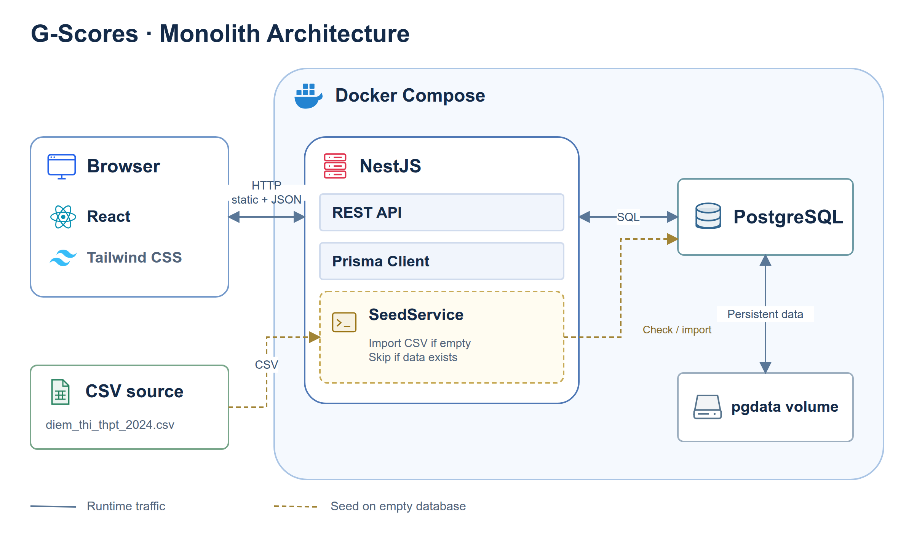

# G-Scores: Architecture and Technology Stack

Status: target architecture. See the [README](../README.md) for the current scaffold and startup instructions, and [features](FEATURES.md) for acceptance criteria. Unless marked current, the sections below describe the target implementation.

## 1. Architecture decision

Use a **modular monolith**: one NestJS application owns score lookup, subject definitions, reports, and combination rankings. It serves the compiled React SPA and the `/api` REST endpoints from the same origin. NestJS supports this static-SPA arrangement through [`@nestjs/serve-static`](https://docs.nestjs.com/recipes/serve-static).

Deploy two persistent containers with Docker Compose:

1. `app`: NestJS API plus compiled React assets in one image and one server process.
2. `db`: PostgreSQL with the `pgdata` named volume.

Migration commands run before application startup using the **same application image**. A seed service inside NestJS imports the CSV when the results table is empty, before the API accepts requests. React executes in the browser; Docker builds and serves its assets.



Editable source: [draw.io diagram](diagrams/g-scores-architecture.drawio).

## 2. Technology stack

| Layer | Choice | Purpose |
|---|---|---|
| Application language | TypeScript with strict checking | All handwritten frontend, backend, seed, and test source uses TypeScript. React components use `.tsx`. |
| Frontend | React with Hooks | Dashboard, score search, subject reports, and combination rankings. |
| Frontend build | Vite, React TypeScript template | Compile the SPA inside the Docker build. |
| Styling | Tailwind CSS | Shared layout, spacing, forms, tables, and basic responsive behavior. |
| Charts (planned) | Chart.js | Stacked/grouped bar charts and score histograms with tooltips and legends. |
| Backend | NestJS with its default HTTP adapter | Modules, controllers, services, DTO validation, error handling, and static asset serving. |
| ORM | Prisma ORM 7, Prisma Client, Prisma Migrate | Typed database access, schema management, and repeatable migrations. |
| Database driver | Prisma PostgreSQL adapter (`@prisma/adapter-pg`) | Connect Prisma Client to PostgreSQL. |
| Database | PostgreSQL | Exact decimal scores, indexed lookup, aggregates, and ranking queries. |
| CSV parsing (planned) | [`csv-parse`, streaming API](https://csv.js.org/parse/api/stream/) | Parse headers, quoted fields, and empty cells without loading the 41 MB file into application memory at once. |
| Input validation (planned) | NestJS `ValidationPipe`, `class-validator`, `class-transformer` | Validate request shapes, reject unexpected fields, and check allowed values. |
| Packaging and execution | Docker multi-stage build + Docker Compose | Containerized install, build, test, migration, seed, and runtime. |
| Bootstrap verification | Node.js built-in test runner and strict TypeScript checks | Two database-readiness unit tests; Docker test target also builds both workspaces. |
| Feature verification (planned) | Jest/Supertest and Vitest/React Testing Library as needed | Add focused statistical/import, API integration, and UI checks with their features; these tools are not installed in the bootstrap. |

### Prisma baseline

Follow the [NestJS Prisma integration](https://docs.nestjs.com/recipes/prisma): inject a `PrismaService` through a `PrismaModule`. Use **Prisma ORM 7**, keep CLI/client/adapter versions compatible, and commit the lockfile.

The bootstrap uses Node.js 24 and PostgreSQL 18. Keep dependency versions compatible and runtime image tags or digests pinned.

## 3. Runtime and request flow

1. A browser requests the application URL; NestJS returns the compiled React files.
2. React requests a small response from `/api`, such as a candidate result, 20 histogram bins, or 10 leaderboard rows.
3. The controller validates the request DTO and delegates to the relevant service.
4. The service applies business rules and delegates persistence or aggregate queries to a concrete feature repository. The repository uses the shared PrismaService to access PostgreSQL and returns a model or read result.
5. The controller maps the service result to a response DTO and returns typed JSON; React renders the table and charts when those features are implemented.

Reserve `/api/*` for API endpoints; a missing API route must return a JSON 404 rather than the SPA HTML. SPA routes such as `/reports` must still work after a browser refresh.

## 4. Planned API layers and module boundaries

Organize the monolith by feature (`subjects`, `scores`, `reports`, and `rankings`). NestJS modules register providers and export services needed by other modules.

| Layer / file convention | Responsibility | Boundary |
|---|---|---|
| Controller (`*.controller.ts`) | HTTP routes, request DTO validation, service calls, response DTO mapping, and HTTP status codes. | No business calculations, Prisma imports, SQL, or direct repository calls. |
| Service (`*.service.ts`) | Business rules, complete-subject eligibility, ranking policies, and coordination between domain services. | Delegate database work to repositories; do not access Prisma directly. Services may compose other services, for example dashboard reports reusing ranking and subject rules. |
| Repository (`*.repository.ts`) | Database reads/writes, query construction, aggregate SQL, and persistence transaction boundaries through PrismaService. | Accept typed criteria and return models/read results; no request/response objects, HTTP exceptions, or DTO validation. |
| Model (`*.model.ts`) | Domain definitions and typed read results used by services and repositories. | No HTTP validation decorators or database client lifecycle. Reuse generated Prisma types where they already fit; do not duplicate every database model. |
| Request DTO (`*.dto.ts`) | Endpoint-specific path/query/body contracts and runtime input-validation rules. | Keep transport validation separate from business rules. Registration numbers remain strings. |
| Response DTO (`*.dto.ts`) | Public JSON response contracts and boundary serialization of domain values. | Keep Prisma Decimal, bigint, and internal database fields out of the public contract unless explicitly serialized. |
| `<feature>.module.ts` | Register controllers, services, repositories, and required module imports/exports. | Wiring only; no business or query logic. |

Planned request flow:

```text
Request DTO -> Controller -> Service -> Repository -> PrismaService -> PostgreSQL
Response DTO <- Controller <- Service <- Model / read result <- Repository
```

| Module | Planned responsibility |
|---|---|
| `AppModule` | Configuration, global request validation, module composition, and static assets. |
| `PrismaModule` | Shared injectable PrismaService, one client/pool per process, and connection lifecycle. Repositories use this provider. |
| `SubjectsModule` | SubjectsController, SubjectsService, subject definitions, and response DTOs. The nine-subject registry is fixed in memory; it needs no database repository or Subject table. |
| `ScoresModule` | ScoresController, ScoresService, ScoresRepository, a score read model, and lookup request/response DTOs. |
| `ReportsModule` | ReportsController, ReportsService, ReportsRepository, summary models, and report DTOs. Aggregate queries execute in its repository; the service coordinates shared domain rules. |
| `RankingsModule` | RankingsController, RankingsService, RankingsRepository, combination/ranking models, and query/response DTOs. |
| `SeedModule` | SeedService runs during application startup and uses SeedRepository to import the CSV only when `exam_results` is empty; no HTTP controller, DTOs, or import-tracking model. |

SubjectsService owns subject rules through OOP. Use concrete feature repositories without a generic BaseRepository, an interface for every class, or duplicate ORM entity classes.

## 5. Data model

The file has a fixed set of nine subjects and 1,061,605 candidate rows. Store one row per candidate and exam year with nullable score columns. This directly reflects the CSV and keeps lookups and three-subject sums straightforward; a generic subject/score join table is unnecessary for the current dataset.

Define persistence models in the root `prisma/schema.prisma`; use feature-local `*.model.ts` files for domain/read projections.

### `ExamResult` mapped to `exam_results`

| Field | PostgreSQL / Prisma representation | Rule |
|---|---|---|
| `examYear` | `smallint` / `Int` | 2024 for the current source; set by the importer because the CSV has no year column. |
| `registrationNumber` | `varchar(8)` / `String` | Exactly eight digits, never an integer. |
| `mathematics` | `numeric(4,2)` / nullable `Decimal` | Maps to `toan`. |
| `literature` | `numeric(4,2)` / nullable `Decimal` | Maps to `ngu_van`. |
| `foreignLanguage` | `numeric(4,2)` / nullable `Decimal` | Maps to `ngoai_ngu`; retain the language code separately. |
| `physics` | `numeric(4,2)` / nullable `Decimal` | Maps to `vat_li`. |
| `chemistry` | `numeric(4,2)` / nullable `Decimal` | Maps to `hoa_hoc`. |
| `biology` | `numeric(4,2)` / nullable `Decimal` | Maps to `sinh_hoc`. |
| `history` | `numeric(4,2)` / nullable `Decimal` | Maps to `lich_su`. |
| `geography` | `numeric(4,2)` / nullable `Decimal` | Maps to `dia_li`. |
| `civicEducation` | `numeric(4,2)` / nullable `Decimal` | Maps to `gdcd`. |
| `foreignLanguageCode` | `varchar(2)` / nullable `String` | Maps to `ma_ngoai_ngu`; preserve raw N1–N7 codes. |

Use the composite primary key `@@id([examYear, registrationNumber])`. It enforces uniqueness and supports exact lookup for the selected year. Add database `CHECK` constraints for the registration-number format and each non-null score's `[0,10]` range in a reviewed SQL migration. Reject source values with more than two decimal places rather than silently rounding on import.

Determine dataset availability and available years directly from `exam_results`. Do not add a Prisma model or database table for import metadata, status, checksums, or timestamps.

No candidate names, schools, province labels, priority categories, or admission outcomes are available in this CSV. Do not invent these fields or infer geography without a verified reference mapping.

## 6. Startup seed, CSV import, and data safety

Apply committed Prisma migrations with `prisma migrate deploy` before application startup. NestJS then awaits SeedService before accepting HTTP requests. No manual seed command or separate seed container is required.

1. Start an import transaction and acquire a transaction-scoped PostgreSQL advisory lock before checking `exam_results`. Concurrent startups wait for the lock and check the table after acquiring it. If any row exists, skip import without reading the CSV or modifying data.
2. If the table is empty, stream `data/diem_thi_thpt_2024.csv` locally, or `/data/diem_thi_thpt_2024.csv` from the app container's read-only mount. Parse UTF-8 with a real CSV parser, validate the expected headers, and set `examYear = 2024`.
3. Preserve registration numbers as strings. Map empty score cells to `null`; validate nonempty values as finite decimal scores in `[0,10]`, with at most two decimal places. Validate the language code and its consistency with the foreign-language score.
4. Write bounded batches, initially 1,000 rows, with Prisma `createMany` inside the transaction. Do not load all rows into memory or skip duplicates; duplicate registration numbers must fail through the primary key.
5. Verify the inserted count against the parsed row count and reject an empty CSV before committing. A malformed row, duplicate, file-read failure, or database error rolls back every inserted row and fails startup. A later startup can retry against the empty table.
6. Log whether seeding ran or was skipped; include row count and elapsed time when importing. Size lock-wait and transaction timeouts for a measured full-file import. The app becomes ready only after seeding completes or is skipped.

Measure import time and transaction size on the full file. Introduce staging/COPY only if measured performance requires it; preserve validation, atomic publication, and the startup check.

Keep migrations, Prisma schema, seed source, and CSV field mapping in the repository. Do not reset or replace existing results automatically. A named volume preserves data across ordinary container recreation; it is not a backup.

## 7. Reporting and database queries

Feature repositories own the Prisma queries that calculate aggregates and ranking totals in PostgreSQL using its [aggregate and statistical functions](https://www.postgresql.org/docs/current/functions-aggregate.html). Services choose business criteria and coordinate results; they do not contain SQL or call Prisma directly. The browser and Node.js server must not fetch all candidate rows to calculate a chart.

- Lookup uses the `(examYear, registrationNumber)` primary key.
- Subject counts use explicit non-null filters; `COUNT(score)` and `COUNT(*)` have different meanings.
- Four bands use the exact boundaries in `FEATURES.md`.
- The histogram always returns 20 bins. Include score 10 in the final bin and fill empty bins with zero.
- Mean, continuous median, and population standard deviation can use PostgreSQL `AVG`, `percentile_cont(0.5)`, and `STDDEV_POP`, plus counts of exact scores 0 and 10.
- A combination query filters all three scores as non-null, applies `foreignLanguageCode = 'N1'` when English is required, sums exact decimal values, and orders by total descending then registration number ascending.
- All combination summaries, distributions, and top-10 results use the same eligibility conditions.
- Use Prisma Client inside repositories for ordinary operations. For SQL features such as median, conditional aggregates, and calculated ranking totals, repositories use static parameterized SQL through Prisma's tagged `$queryRaw` or TypedSQL. Never interpolate request text as an identifier or use an unsafe query method. Prisma documents the relevant [raw-query boundaries](https://www.prisma.io/docs/orm/v7/prisma-client/using-raw-sql/raw-queries).
- Select subject fields and combination expressions from hardcoded trusted definitions. Query values such as year remain bound parameters.
- Serialize counts as JSON integers and scores/statistics as finite JSON numbers or `null`. Explicitly handle Prisma Decimal and PostgreSQL bigint outputs; preserve precision until the response boundary and round only for display.

Start with the primary key and database aggregation. Check representative plans and response times on the full dataset before adding indexes or precomputed tables. Redis, a job queue, and a separate analytics database are outside the initial architecture.

## 8. Proposed REST API

| Method and path | Response / purpose |
|---|---|
| `GET /api/subjects` | Nine allowed subject codes and English labels. |
| `GET /api/combinations` | Six supported combination codes, labels, and required subjects. |
| `GET /api/scores/:registrationNumber?year=2024` | One candidate's scores and language code, preserving nulls. |
| `GET /api/dashboard?year=2024&subject=mathematics&combination=A00` | Source filename, dataset availability, total candidates, subject summaries, and selected report/ranking previews. Reuse report-service logic. |
| `GET /api/reports/levels?year=2024` | Four nonoverlapping counts per subject, with valid/missing totals. |
| `GET /api/reports/subjects/:subject/histogram?year=2024` | 20 ordered bins plus valid count, mean, median, population standard deviation, zero count, and ten count. |
| `GET /api/reports/combinations/:code?year=2024` | Eligible count, mean/highest total, 30 total-score bins, and at most 10 ranked candidates. |

Histogram bin records include `lowerBound`, `upperBound`, `upperInclusive`, and `count`; percentages use the returned valid count. Return a stable empty array/table shape with zero-filled bins when there are no valid scores. Derived statistics remain `null`.

Return 400 for malformed/unknown subject, combination, or year input; 404 for a well-formed registration number absent from an available dataset; 503 when the database is unavailable or the requested dataset has not yet been initialized. Responses and logs must not reveal database credentials, SQL text containing private inputs, or stack traces to users.

## 9. Docker build and execution contract

Use a multi-stage Dockerfile: install locked dependencies, generate Prisma Client, type-check and compile both applications, then package the NestJS build and React assets. Generate the client **before** backend compilation. The runtime image must contain the pinned Prisma CLI, migrations/configuration, and compiled seed service. Make the CSV available through the app container's read-only data mount.

| Service / resource | Execution rule |
|---|---|
| `app` | One NestJS process, non-root runtime user, bind server to `0.0.0.0`, expose only the application port. |
| `db` | PostgreSQL, reachable by service name on the Compose network; no host database port required. |
| Startup (planned) | Apply migrations with the app image, then start NestJS; its seed service imports only into an empty results table before accepting requests. |
| `pgdata` | Named volume for PostgreSQL persistence. |
| `data` mount | Mount `./data:/data:ro` on `app` for startup seeding; never expose the CSV as public static content. |
| Secrets | Runtime environment / untracked `.env`; commit an `.env.example` containing placeholders only. No database URL in browser variables. |

See the [README](../README.md) for current local development, Docker startup, checks, and shutdown commands. Business migrations and startup seeding are not implemented yet.

When implementing startup seeding, register SeedModule in AppModule, add the app's read-only data mount, and document the migration-before-startup workflow.

Before a later public release, provide HTTPS and access controls for any private administration functions. The web interface exposes read-only operations; startup seeding has no HTTP endpoint.

## 10. Project structure

Current workspace structure. Business feature folders are empty placeholders; section 4 defines their planned responsibilities.

```text
.
├── apps/
│   ├── web/
│   │   ├── src/
│   │   │   ├── app/
│   │   │   ├── components/
│   │   │   ├── hooks/
│   │   │   ├── lib/
│   │   │   ├── features/
│   │   │   │   ├── dashboard/
│   │   │   │   ├── scores/
│   │   │   │   ├── reports/
│   │   │   │   └── rankings/
│   │   │   ├── styles/
│   │   │   └── main.tsx
│   │   ├── index.html
│   │   ├── vite.config.ts
│   │   ├── tsconfig.json
│   │   └── package.json
│   └── api/
│       ├── src/
│       │   ├── prisma/
│       │   ├── subjects/
│       │   ├── scores/
│       │   ├── reports/
│       │   ├── rankings/
│       │   ├── seed/
│       │   ├── app.module.ts
│       │   └── main.ts
│       ├── tsconfig.json
│       └── package.json
├── prisma/
│   ├── schema.prisma
│   └── migrations/
├── prisma.config.ts
├── data/
├── docs/
│   ├── ARCHITECTURE.md
│   ├── FEATURES.md
│   └── diagrams/
├── Dockerfile
├── compose.yaml
├── .env.example
├── package.json
├── package-lock.json
└── README.md
```

**API:** Business features follow section 4; `seed` contains the startup seed service and repository.

**React:** Shared Hooks belong in `hooks`; feature-specific Hooks stay with their feature. Shared UI belongs in `components` and shared helpers in `lib`.

**Generated files:** Prisma Client is generated into the ignored `apps/api/src/generated/prisma` directory.

npm workspaces share one lockfile.

## 11. Implementation order and focused verification

1. Verify the existing TypeScript/Docker bootstrap, then implement the business schema, migrations, and the planned feature-local controller/service/repository/model/DTO files when feature work starts.
2. Build and verify startup seeding: empty-table import, populated-table skip, restart without reimport, concurrent startup, rollback/retry, leading zeros, missing scores, and language codes.
3. Implement lookup and statistics APIs with database-level aggregation and deterministic rankings.
4. Build the dashboard, score-search page, subject reports, and combination reports using the same response contracts.
5. Verify the complete local Docker workflow and update the root README with actual commands; add responsive polish and optional features afterward.

Use a small fixture containing nulls, zero, boundary scores 0.5/4/6/8/9.5/10, a non-English foreign-language score, incomplete combinations, and tied totals. Assert histogram/band totals, known mean/median/population standard deviation, exclusion rules, deterministic top 10, and API error states. Verify malformed and duplicate CSV rows roll back every inserted result and fail startup. Check that a later startup retries after rollback, and that concurrent starts import only once. Test database behavior against a disposable PostgreSQL container rather than relying only on mocked Prisma methods.

For frontend checks, cover lookup success/not-found/validation, dashboard rendering, and chart empty/error states. Finally run one full-data import and reconcile the row, per-subject, and combination counts in `FEATURES.md`. Measure import duration and representative query latency before making performance claims.
