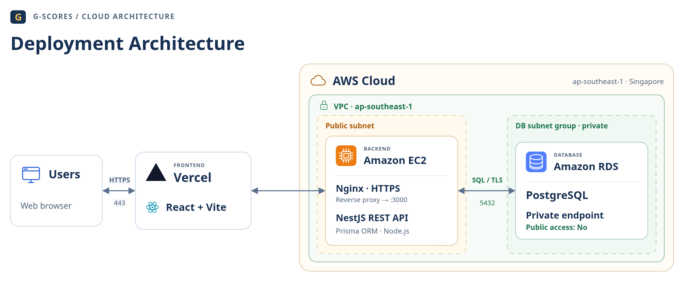

# G-Scores deployment configuration

Configuration reference for the demo environment: React/Vite on Vercel, NestJS in Docker on EC2, and PostgreSQL on RDS. All AWS resources are in **ap-southeast-1 (Singapore)**.

**Demo:** [https://g-scores-eight.vercel.app/](https://g-scores-eight.vercel.app/)



## Overview

| Component | Configuration |
|---|---|
| Frontend | Vercel, project `qbaels-projects/g-scores` |
| Public API | `https://56.10.159.40/api` |
| Backend | One EC2 `t4g.micro` instance, with Docker and Nginx on the host |
| Database | One private RDS `db.t4g.micro` instance, PostgreSQL 18.6, Single-AZ |
| Request flow | Browser → Vercel → Nginx on EC2 → NestJS → RDS |
| Content delivery | Managed by Vercel; no separate AWS CDN |
| Additional networking | No NAT Gateway or Load Balancer |

## Frontend — Vercel

| Property | Value |
|---|---|
| Framework | React + Vite |
| Production domain | `g-scores-eight.vercel.app` |
| Source directory | `apps/web` |
| Project Root Directory | `.`, relative to the source uploaded from `apps/web` |
| Node.js | `24.x` |
| Install Command | `npm ci` |
| Build Command | `npm run build` |
| Output Directory | `dist` |
| Git integration | Not connected |
| Frontend TLS | Managed by Vercel |
| Upload exclusions | `.env*`, defined in [`.vercelignore`](../apps/web/.vercelignore) |

Routing configuration in [`apps/web/vercel.json`](../apps/web/vercel.json):

```json
{
  "$schema": "https://openapi.vercel.sh/vercel.json",
  "installCommand": "npm ci",
  "rewrites": [
    {
      "source": "/api/:path*",
      "destination": "https://56.10.159.40/api/:path*"
    },
    {
      "source": "/(.*)",
      "destination": "/index.html"
    }
  ],
  "buildCommand": "npm run build"
}
```

The frontend uses relative `/api/...` URLs. The API rewrite precedes the SPA fallback and preserves the `/api` prefix and query string. Routes `/`, `/scores`, `/reports`, and `/rankings` use the `/index.html` fallback.

The production frontend requires no API or database connection environment variables. `API_PROXY_TARGET` applies only to the Vite development server; `WEB_PORT` applies only to local Docker.

## Backend — EC2 and Docker

| Property | Value |
|---|---|
| EC2 instance | `i-055f77c1975d9fef5` |
| Instance type | `t4g.micro`, ARM64 |
| Operating system | Ubuntu Server 24.04 LTS |
| CPU credits | `standard` |
| EBS | gp3, 8 GiB |
| Swap | 1 GiB |
| Elastic IP | `56.10.159.40` |
| Dockerfile | [`apps/api/Dockerfile`](../apps/api/Dockerfile), target `runtime` |
| Docker image | `g-scores-api:c72e76d853d6-arm64` |
| Container | `g-scores-api` |
| Runtime | Node.js 24, user `node`, working directory `/app` |
| Container startup command | `node dist/main.js`; migrations run separately from the API process |
| Restart policy | `unless-stopped` |
| Container port | `3000`, with NestJS listening on `0.0.0.0` |
| Published host port | `127.0.0.1:3000:3000` |
| API prefix | `/api` |
| Docker log rotation | `max-size=10m`, `max-file=3` |

### Environment variables

Backend environment file: `/opt/g-scores/api.env`, permissions `0600`.

```dotenv
NODE_ENV=production
PORT=3000
DATABASE_URL=postgresql://g_scores:<URL_ENCODED_PASSWORD>@g-scores-db.c7qgaem64gqm.ap-southeast-1.rds.amazonaws.com:5432/g_scores?schema=public&sslmode=verify-full&sslrootcert=/certs/ap-southeast-1-bundle.pem
```

`<URL_ENCODED_PASSWORD>` is the percent-encoded password for database user `g_scores`. Docker env file values have no `export` prefix or surrounding quotes. `DATABASE_URL` takes precedence over `POSTGRES_*` variables.

Passwords and SSH private keys are stored outside the repository. Database connection details belong only to the backend and are excluded from Vercel configuration and `VITE_*` variables.

### Volume mounts

| EC2 host path | Container path | Access |
|---|---|---|
| `/opt/g-scores/data` | `/data` | Read-only |
| `/opt/g-scores/certs` | `/certs` | Read-only |

## Database — RDS PostgreSQL

| Property | Value |
|---|---|
| DB identifier | `g-scores-db` |
| Engine | PostgreSQL 18.6 |
| Instance class | `db.t4g.micro` |
| Availability | Single-AZ |
| Storage | gp2, 5 GiB |
| Endpoint | `g-scores-db.c7qgaem64gqm.ap-southeast-1.rds.amazonaws.com` |
| Port | `5432` |
| Database / schema | `g_scores` / `public` |
| Application user | `g_scores`; the runtime does not use the master user |
| Public access | No |
| DB subnet group | `g-scores-demo`, with two private subnets in two AZs within the same VPC |
| Parameter group | `g-scores-postgres18`, `rds.force_ssl=1` |

### Database connection TLS

| Component | Configuration |
|---|---|
| CA bundle on EC2 | `/opt/g-scores/certs/ap-southeast-1-bundle.pem` |
| CA bundle in the container | `/certs/ap-southeast-1-bundle.pem` |
| API runtime, `pg` driver | `sslmode=verify-full`, `sslrootcert=/certs/ap-southeast-1-bundle.pem` |
| Prisma Migrate | `sslmode=require`, `sslcert=/certs/ap-southeast-1-bundle.pem`, `sslaccept=strict` |
| Migration-specific environment variable | `SSL_CERT_FILE=/certs/ap-southeast-1-bundle.pem` |

The runtime verifies the CA and RDS hostname. The migration connection URL is separate from the API's `DATABASE_URL`.

## Networking and security groups

| Resource | Configuration |
|---|---|
| VPC | `vpc-0278140498c4823f1` |
| EC2 public subnet | `subnet-08f0bf3459ecc0f4d`, with an Internet route through an Internet Gateway |
| Private DB subnet A | `subnet-02fee44e5c4a514c3` |
| Private DB subnet B | `subnet-0b713e8ee95b5559b` |
| EC2 security group | `sg-0a8d08681a7562b5a` |
| RDS security group | `sg-0d1693ec404a4f243` |

| Destination | Inbound | Source |
|---|---|---|
| EC2 | TCP 22 / SSH | Administrator IP, `/32` |
| EC2 | TCP 80 / HTTP | `0.0.0.0/0` |
| EC2 | TCP 443 / HTTPS | `0.0.0.0/0` |
| RDS | TCP 5432 / PostgreSQL | EC2 security group `sg-0a8d08681a7562b5a` |

Port `3000` is published only on the EC2 loopback interface. RDS accepts no connections from the Internet. The HTTPS API is a public read-only endpoint without authentication; the Vercel rewrite does not restrict direct API access.

## Nginx and API HTTPS

| Property | Configuration |
|---|---|
| API origin | `https://56.10.159.40`, without a custom domain |
| Reverse proxy | `/api/` → `http://127.0.0.1:3000`, preserving the `/api` prefix |
| HTTP port 80 | `/.well-known/acme-challenge/` serves ACME; all other paths redirect to HTTPS |
| HTTPS port 443 | Nginx terminates TLS and forwards API requests to NestJS |
| Certificate | Let's Encrypt IP certificate, `shortlived` profile |
| Certificate directory | `/etc/letsencrypt/live/g-scores-api/` |
| ACME client | Certbot, webroot |
| Renewal timer | `snap.certbot.renew.timer` |
| Certificate deploy hook | `/etc/letsencrypt/renewal-hooks/deploy/g-scores-nginx`, validates and reloads Nginx |

## Application data

| Property | Configuration |
|---|---|
| Exam year | `2024` |
| Dataset | `diem_thi_thpt_2024.csv` |
| CSV in the container | `/data/diem_thi_thpt_2024.csv` |
| Data table | `exam_results` |
| Seed | NestJS lifecycle; imports only when the table has no rows |
| Import transaction | Atomic, with an advisory lock and a 10-minute timeout |
| API listen timing | After the import completes or is skipped |

The CSV is excluded from the frontend bundle. When the table already contains data, seeding preserves existing records. The single EC2 instance and Single-AZ RDS configuration have no automatic standby.
